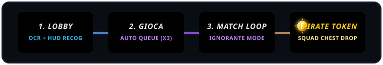

<p align="center">
  
</p>

<p align="center">
  
</p>

<p align="center">
  
  
  
  
</p>

<p align="center">
  
</p>

<div align="center">
  
  <br />
  <sub><b>PIRATE SHOP ACCESS TOKEN (TREASURE HUNTERS EVENT)</b></sub>
</div>

<br />

## 🪙 What is Oye & The Pirate Token?

During the Fortnite *Treasure Hunters* event, the **Pirate Shop Token** is a legendary golden coin that grants **28 days of free Item Shop access**. It drops at random from in-game chests with ultra-rare odds (estimated 1 in 137,500+).

**The Squad Advantage:** If any player in a Duo, Trio, or Squad opens a chest containing the token, **the entire squad receives the Pirate Shop Access**.

**Oye** is an autonomous screen observer and match looper for Windows. It keeps your character queued and active in squad matches while you are AFK:
- Detects the lobby and clicks **`GIOCA`** automatically.
- Runs **Ignorante** mode: handles match transitions, safe jumping, basic traversal, and interactions.
- Keeps you in the game with your squad to maximize chest opportunities without manual grinding.

> **⚠️ Disclaimer & Limits:** Automation can violate Epic Games terms of service. Oye contains **no anti-cheat evasion** and sends synthetic OS input. Test strictly on a secondary account. Oye does not alter chest drop math or guarantee finding the token. See [Honest Limits](#-honest-limits).

<p align="center">
  
</p>

## ⚡ The Match Loop

<p align="center">
  
</p>

1. **Lobby:** OCR scanners (Tesseract) and a visual HUD classifier verify you are back in the lobby.
2. **GIOCA Queue:** Oye targets the `GIOCA` button with guarded clicks (up to 3 attempts, spaced 12 seconds).
3. **Match Loop:** **Ignorante** mode executes basic keyboard/mouse routines (movement, jumps, pickaxe, `E` interact).
4. **Token Claim:** When a chest drops the token, the reward applies across the team.

<p align="center">
  
</p>

## 🏆 Loot & Features



| Rarity | Feature |
|---|---|
| **Common** | Prebuilt standalone Windows `.exe` and installer — zero Python required for end users |
| **Common** | Hotkey safety: `F8` pause, `F9` instant killswitch; input sent only when Fortnite is focused |
| **Rare** | Modular Tesseract OCR scanners for lobby, spectate, rewards, and restart screens |
| **Rare** | Pretrained visual neural classifier detecting game phases from HUD layout |
| **Epic** | **Ignorante** Mode: autonomous match looper (movement, jump, pickaxe, interact, queue) |
| **Epic** | **Studio** Dashboard: frame-by-frame move recorder, visual reviewer, and telemetry diagnostics |
| **Legendary** | Deterministic offline replay on full screenshot sets with checksum verification |

<br clear="right" />

<p align="center">
  
</p>

## 📦 Drop In (Installation)

<p align="center">
  
</p>

### Option 1 — Prebuilt Binaries (Easiest)

1. Open **Actions → Build Windows EXE** and download the latest green run:
   - `OyeStudio-windows-x64`: Portable build. Extract and launch `OyeStudio.exe`.
   - `Oye-Setup-windows-x64`: Single installer package (`Oye-v44-Setup-Windows-x64.exe`).
2. Run OCR installer (required for text scanning):
   ```bat
   installa_ocr_windows.bat

Option 2 — Run from Source

bat

installa_windows.bat
AVVIA_OYE.bat

Data and recorded sessions are stored in %LOCALAPPDATA%/Oye.
<p align="center">  </p>
🎮 Controls & Usage

    Launch OyeStudio.exe or AVVIA_OYE.bat.
    Select Ignorante mode and activate.
    Switch to Fortnite in Squads mode.
    Verify HUD detection inside the Studio telemetry panel.

Hotkey	Action
F8	Pause match loop
F9	Emergency Stop
Developer & Diagnostics Commands

PowerShell

# Retrain visual HUD model
python tools/train_visual.py --manifest assets/pretrained/manifest.json --images frames

# Run test suite & studio smoke test
python -m pytest -q
python studio.py --smoke-test

<p align="center">  </p>
⚠️ Honest Limits

    Input Acceptance: Live acceptance of OS synthetic input varies across Windows and GPU setups.
    Dataset Size: Pretrained classifier was trained on 72 curated screenshots and tested on 24 held-out frames (21 correct, 3 abstentions).
    Zero Combat AI: Oye does not aim, build, or fight opponents.
    HUD Fragility: Custom aspect ratios, UI scale changes, and future Fortnite seasonal HUD overhauls require scanner adjustments.

Documentation & Guides

    🇮🇹 Guida completa in Italiano (LEGGIMI.md)
    🔍 Ignorante Mode Diagnostics
    💾 Local Data & Backups Guide

<p align="center">  </p>
🗺️ Battle Pass Roadmap

    Season 1 — Screen capture engine, OCR pipeline, pretrained visual HUD recognizer
    Season 2 — Ignorante mode rule-based loop with guarded GIOCA lobby clicker
    Season 3 — Telemetry-driven keyframe imitation learning from Studio recordings
    Season 4 — Multi-resolution support and automatic patch calibration

🤝 Contributing

Pull requests are welcome! Ensure tests pass before submitting:

PowerShell

python -m pytest -q
python studio.py --smoke-test

Contributions implementing memory injection, DLL hooking, or anti-cheat tampering will not be accepted.
📄 License

Distributed under the GPL License. See LICENSE for details.
